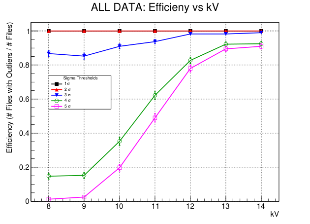
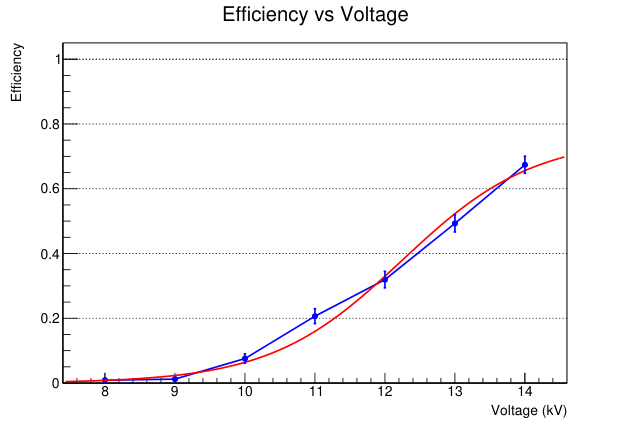

# ASIoP 2025 — RPC high-voltage scan (data + analysis)

Raw data and analysis code from a **resistive plate chamber (RPC)** high-voltage scan taken during
ASIoP 2025. The chamber was stepped from **8 kV to 14 kV** and its response was recorded two ways:

1. **Oscilloscope waveforms:** a Tektronix MDO34, 100 triggered captures per voltage per day, 4 channels.
2. **TDC hits:** raw binary dumps from a CAEN V1290 TDC, one run per voltage.

The goal is the **efficiency curve**, the fraction of triggers in which the chamber produced a signal, as a
function of voltage. It shows where the detector turns on and where it starts to plateau.

## Results at a glance

| Scope captures (all days, 2 800 files) | TDC runs (8–14 kV) |
|---|---|
|  |  |
| Fraction of captures with a sample beyond *n*σ of the baseline, for *n* = 1…5. At 4–5σ the efficiency rises from ~0–15% at 8–9 kV to ~90% at 13–14 kV. | Fraction of events with at least one TDC hit. It rises from ~0 at 8 kV to ~0.67 at 14 kV, with a logistic fit (red) and binomial error bars. |

The PNGs above are rendered from the original ROOT outputs in `plots-0721/ALL_DATA_Efficiency_vs_kV.pdf`
and `rpc_analysis_project/efficiency_vs_voltage.pdf`.

## How each analysis works

### Scope waveforms → efficiency vs threshold
`ASIoP_Data_all/count_outlier_files_with_efficiency_plot.C` (ROOT/ACLiC macro):

1. Read each Tek CSV (`TIME, CH1…CH4`; 1 000 samples at 0.4 ns) and sum **CH2 + CH3 + CH4** per sample.
2. Estimate the **baseline** mean and σ from the pre-trigger rows (22–98), pooled across *all* files.
   This gives noise statistics that don't depend on any one capture.
3. For *n* = 1…5, mark a capture as a **hit** if any later sample falls outside mean ± *n*σ.
4. Group captures by voltage (from the file number) and compute efficiency = hits / captures, with
   binomial (1σ) error bars.

The 1σ and 2σ curves sit at 100% because noise alone crosses those thresholds. The 4σ and 5σ curves are
the meaningful ones.

### TDC binary → ROOT tree → efficiency vs voltage
`rpc_analysis_project/improved_ana.cc` (C++17 + ROOT):

- Decodes the CAEN V1290 data words (global header/trailer, TDC header/trailer, measurement words,
  extended trigger time tag). Measurement LSB = 25 ns / 1024 ≈ 24.4 ps.
- Writes per-event hit trees to `rawdata_<N>kV.root`.
- Efficiency = events with ≥ 1 hit / valid events, with binomial error.
- Sorts the runs by the voltage in each filename and plots efficiency vs voltage with a logistic fit.

### Data wrangling
- `process_asiop_data.sh <MMDD>` and `automate_asiop_data.sh`: for each voltage folder, run
  `rename_csv_files.C` in ROOT batch mode. The renamed files' numbers encode the voltage. Then
  consolidate everything into one `…-all` folder.
- `ASIoP_DataMMDD/filter_and_plot_all_folders.C`: per-folder amplitude histograms after a 3σ
  filter; writes `…_kv-#files_with_outliers.txt` with outlier counts per voltage and σ.

## Repository layout

```
ASIoP_Data0709/          partial day: 8, 9, 10, 12 kV × 100 captures
ASIoP_Data0716/          full day: 8–14 kV × 100 captures, + per-day macros and outlier table
ASIoP_Data0717/  0718/  0721/   same layout, one folder per day
ASIoP_Data_all/          all 2 800 renamed captures + the efficiency-plot macro
plots-0721/              ROOT output PDFs: per-day and combined efficiency, mean/σ vs kV, densities
rpc_analysis_project/    TDC decoder (improved_ana.cc), raw .bin runs, .root trees, efficiency PDFs
testing_stuff/           early prototypes (ana.cpp, taylor_exp.py)
```

`*.csv:Zone.Identifier` files are Windows download metadata, not data, and can be ignored.

## Reproduce

You need [ROOT](https://root.cern) 6.x with a C++17 compiler.

```bash
# scope efficiency, all days combined (writes the efficiency-vs-kV plot)
cd ASIoP_Data_all
root -l -b -q 'count_outlier_files_with_efficiency_plot.C+'

# TDC efficiency vs voltage
cd rpc_analysis_project
g++ -std=c++17 improved_ana.cc $(root-config --cflags --libs) -o improved_ana
./improved_ana          # decodes rawdata_*kV.bin, prints per-run efficiency, writes efficiency_vs_voltage.pdf
```

## Limitations

- The efficiency definition is a **threshold-crossing proxy**: any sample beyond *n*σ counts as a hit. It
  isn't a full pulse-shape or coincidence analysis, which is why the reported result depends on *n*.
- The TDC curve has not reached a plateau by 14 kV, so the operating point would need higher voltages to pin down.
- Day 0709 is incomplete (11, 13 and 14 kV are missing). The combined plot uses 0716–0721.
